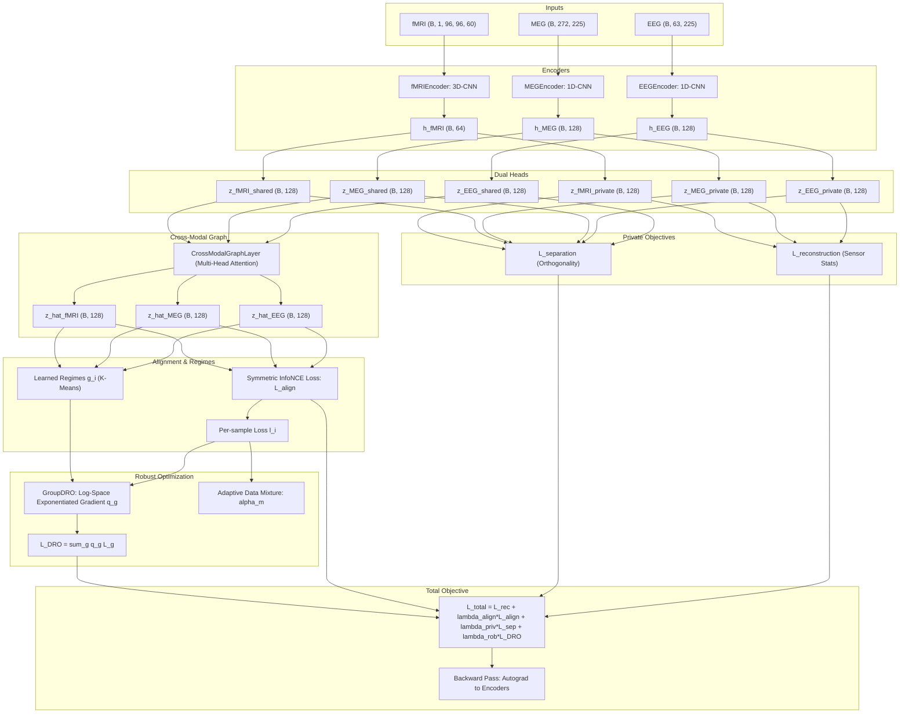

# Neuro-GRAPE: Complete Mathematical Specification & System Architecture

**Author:** Member 3 (Downstream Evaluation, GroupDRO, & Architecture Audit)  
**Date:** October 2026  
**Reference Document:** `docs/Neuro-GRAPE.pdf`  
**Deliverable:** Phase 2 Mathematical & Operational Specification

---

## 1. Executive Overview

This document formalizes the complete mathematical formulation, tensor contracts, and computational flow for the **Neuro-GRAPE** foundation learning framework. It provides explicit equations, tensor dimensions, optimization dynamics, and gradient flow for all 10 components proposed in [`docs/Neuro-GRAPE.pdf`](file:///d:/hciproj/NEURO_GRAPE/docs/Neuro-GRAPE.pdf).

The unified training objective is:
$$\mathcal{L}_{\text{total}} = \lambda_{\text{recon}} \mathcal{L}_{\text{reconstruction}} + \lambda_{\text{align}} \mathcal{L}_{\text{alignment}} + \lambda_{\text{private}} \mathcal{L}_{\text{separation}} + \lambda_{\text{robust}} \mathcal{L}_{\text{DRO}}$$

---

## 2. Mathematical Definition of Architecture Components

### 2.1 Modality-Specific Encoders

Neuro-GRAPE ingests three heterogeneous neural signal modalities synchronized through shared concept identifiers $y_i \in \{1, \dots, C\}$:

1. **EEG Input:** $x_{i}^{\text{EEG}} \in \mathbb{R}^{C_{\text{EEG}} \times T_{\text{EEG}}}$, where $C_{\text{EEG}} = 63$ channels and $T_{\text{EEG}} = 225$ time points (sampled at 250 Hz, interval $[-100, 800]$ ms relative to stimulus onset).
2. **MEG Input:** $x_{i}^{\text{MEG}} \in \mathbb{R}^{C_{\text{MEG}} \times T_{\text{MEG}}}$, where $C_{\text{MEG}} = 272$ axial gradiometer channels and $T_{\text{MEG}} = 225$ time points (sampled at 250 Hz).
3. **fMRI Input:** $x_{i}^{\text{fMRI}} \in \mathbb{R}^{1 \times X \times Y \times Z}$, where spatial resolution is $(X, Y, Z) = (96, 96, 60)$ voxels representing trial-wise GLM beta response maps.

#### Backbone Architectures:
- **EEG Backbone ($f_{\theta_{\text{EEG}}}$):** 1D Temporal CNN
  $$\text{Conv1d}(63 \to 32, k=7, s=2, p=3) \to \text{BN} \to \text{GELU} \to \text{Conv1d}(32 \to 64, k=5, s=2, p=2) \to \text{BN} \to \text{GELU} \to \text{Conv1d}(64 \to 128, k=3, s=1, p=1) \to \text{GELU} \to \text{AdaptiveAvgPool1d}(1)$$
  Output representation: $h_{i}^{\text{EEG}} \in \mathbb{R}^{128}$.

- **MEG Backbone ($f_{\theta_{\text{MEG}}}$):** 1D Temporal CNN
  $$\text{Conv1d}(272 \to 32, k=7, s=2, p=3) \to \text{BN} \to \text{GELU} \to \text{Conv1d}(32 \to 64, k=5, s=2, p=2) \to \text{BN} \to \text{GELU} \to \text{Conv1d}(64 \to 128, k=3, s=1, p=1) \to \text{GELU} \to \text{AdaptiveAvgPool1d}(1)$$
  Output representation: $h_{i}^{\text{MEG}} \in \mathbb{R}^{128}$.

- **fMRI Backbone ($f_{\theta_{\text{fMRI}}}$):** 3D Spatial CNN
  $$\text{Conv3d}(1 \to 16, k=3, s=2, p=1) \to \text{BN} \to \text{GELU} \to \text{Conv3d}(16 \to 32, k=3, s=2, p=1) \to \text{BN} \to \text{GELU} \to \text{Conv3d}(32 \to 64, k=3, s=2, p=1) \to \text{GELU} \to \text{AdaptiveAvgPool3d}(1)$$
  Output representation: $h_{i}^{\text{fMRI}} \in \mathbb{R}^{64}$.

---

### 2.2 Shared and Private Representation Heads

For each modality $m \in \mathcal{M} = \{\text{EEG}, \text{MEG}, \text{fMRI}\}$, the hidden representation $h_{i}^{m}$ is projected into two distinct latent subspaces of dimension $D = 128$:

1. **Shared Representation ($\tilde{z}_{i, m, \text{shared}} \in \mathcal{S}^{D-1}$):**
   Captures modality-invariant semantic visual concept structure.
   $$z_{i, m, \text{shared}} = \text{LayerNorm}\left( W_{\text{shared}}^{(m)} h_{i}^{m} \right) \in \mathbb{R}^{D}$$
   $$\tilde{z}_{i, m, \text{shared}} = \frac{z_{i, m, \text{shared}}}{\|z_{i, m, \text{shared}}\|_2}$$

2. **Private Representation ($\tilde{z}_{i, m, \text{private}} \in \mathcal{S}^{D-1}$):**
   Retains modality-specific temporal or spatial features (e.g. sensor layout geometry, latency phase, hemodynamic response lag).
   $$z_{i, m, \text{private}} = \text{LayerNorm}\left( W_{\text{private}}^{(m)} h_{i}^{m} \right) \in \mathbb{R}^{D}$$
   $$\tilde{z}_{i, m, \text{private}} = \frac{z_{i, m, \text{private}}}{\|z_{i, m, \text{private}}\|_2}$$

Here $W_{\text{shared}}^{(m)}$ and $W_{\text{private}}^{(m)}$ have shapes:
- EEG, MEG: $128 \times 128$
- fMRI: $128 \times 64$
$\text{LayerNorm}$ normalizes across the $D$ feature dimensions, ensuring stable centering before hypersphere normalization.

---

### 2.3 Cross-Modal Graph Layer

To model semantic and representational relationships across modalities explicitly, a differentiable graph attention layer operates over the shared representations of each mini-batch:

- **Graph Structure for Batch $B$:**
  For each stimulus concept $i \in \{1, \dots, B\}$, there exist 3 modality nodes:
  $$\mathcal{V}_i = \{ v_{i, \text{EEG}}, v_{i, \text{MEG}}, v_{i, \text{fMRI}} \}$$
  Initial node feature vector: $u_{i, m}^{(0)} = \tilde{z}_{i, m, \text{shared}} \in \mathbb{R}^{D}$.

- **Edges:**
  Within each concept $i$, bidirectional edges connect all modality pairs: $\mathcal{E}_i = \{ (m, m') \mid m, m' \in \mathcal{M} \}$.
  Cross-concept relational edges can optionally connect stimuli sharing high semantic affinity.

- **Graph Attention Operation (Message Passing):**
  Attention coefficients between modality $m$ and modality $m'$ for concept $i$:
  $$A_{i, (m, m')} = \frac{\exp\left( \frac{(W_Q u_{i, m}^{(0)})^\top (W_K u_{i, m'}^{(0)})}{\sqrt{d_k}} \right)}{\sum_{m'' \in \mathcal{M}} \exp\left( \frac{(W_Q u_{i, m}^{(0)})^\top (W_K u_{i, m''}^{(0)})}{\sqrt{d_k}} \right)}$$
  where $W_Q, W_K, W_V \in \mathbb{R}^{D \times D}$ and $d_k = D = 128$.

  Message aggregation with residual connection:
  $$u_{i, m}^{(1)} = \text{LayerNorm}\left( u_{i, m}^{(0)} + \sum_{m' \in \mathcal{M}} A_{i, (m, m')} W_V u_{i, m'}^{(0)} \right)$$

- **Graph-Refined Shared Embedding:**
  $$\hat{z}_{i, m, \text{shared}} = \frac{u_{i, m}^{(1)}}{\|u_{i, m}^{(1)}\|_2} \in \mathcal{S}^{D-1}$$
  When the graph layer is disabled (ablation G6), $\hat{z}_{i, m, \text{shared}} = \tilde{z}_{i, m, \text{shared}}$.

---

### 2.4 Cross-Modal Alignment Loss ($\mathcal{L}_{\text{alignment}}$)

The alignment objective enforces concept correspondence across separate recordings without requiring simultaneous acquisition:

- For each modality pair $(p, q) \in \{(\text{EEG}, \text{MEG}), (\text{EEG}, \text{fMRI}), (\text{MEG}, \text{fMRI})\}$ in a mini-batch of size $B$:
  Cosine similarity logits with temperature $\tau = 0.07$:
  $$S_{i, j}^{(p, q)} = \frac{\hat{z}_{i, p, \text{shared}}^\top \hat{z}_{j, q, \text{shared}}}{\tau}$$

- Symmetric InfoNCE pairwise loss:
  $$\ell^{(p, q)}(i) = \frac{1}{2} \left[ -\log \frac{\exp\left( S_{i, i}^{(p, q)} \right)}{\sum_{j=1}^B \exp\left( S_{i, j}^{(p, q)} \right)} - \log \frac{\exp\left( S_{i, i}^{(p, q)} \right)}{\sum_{j=1}^B \exp\left( S_{j, i}^{(p, q)} \right)} \right]$$

- Batch Alignment Loss:
  $$\mathcal{L}_{\text{alignment}} = \frac{1}{3 B} \sum_{(p, q)} \sum_{i=1}^B \ell^{(p, q)}(i)$$

- Per-Sample Alignment Loss $\ell_{\text{align}}(i) \in \mathbb{R}$:
  $$\ell_{\text{align}}(i) = \frac{1}{3} \sum_{(p, q)} \ell^{(p, q)}(i)$$

---

### 2.5 Private Representation Separation & Preservation Objective

To prevent shared and private heads from collapsing onto identical features:

1. **Orthogonality Separation Objective ($\mathcal{L}_{\text{separation}}$):**
   Penalizes linear correlation between the shared and private subspaces:
   $$\mathcal{L}_{\text{ortho}, m} = \frac{1}{B} \sum_{i=1}^B \left( \tilde{z}_{i, m, \text{shared}}^\top \tilde{z}_{i, m, \text{private}} \right)^2$$
   $$\mathcal{L}_{\text{separation}} = \frac{1}{|\mathcal{M}|} \sum_{m \in \mathcal{M}} \mathcal{L}_{\text{ortho}, m}$$
   This objective reaches 0 if and only if shared and private embeddings are strictly orthogonal in $\mathbb{R}^D$.

2. **Private Reconstruction / Preservation Objective ($\mathcal{L}_{\text{reconstruction}}$):**
   To ensure the private head preserves usable modality-specific features (rather than collapsing to a constant or trivial vector orthogonal to shared space), each private embedding predicts summary statistics of its raw inputs:
   $$\hat{s}_{i, m} = \text{Decoder}_m\left( \tilde{z}_{i, m, \text{private}} \right)$$
   $$\mathcal{L}_{\text{reconstruction}} = \frac{1}{|\mathcal{M}| B} \sum_{m \in \mathcal{M}} \sum_{i=1}^B \| \hat{s}_{i, m} - s_{i, m} \|_2^2$$
   where $s_{i, m} \in \mathbb{R}^{C_m}$ represents the sensor/channel energy summary $\frac{1}{T_m} \sum_{t} (x_{i, m, c, t})^2$ (for EEG/MEG) and spatial slice variance (for fMRI), and $\text{Decoder}_m: \mathbb{R}^D \to \mathbb{R}^{C_m}$ is a single linear layer.

---

### 2.6 Neural Regime Discovery

Instead of relying solely on predefined categorical labels (e.g. animate vs inanimate), latent difficulty regimes are discovered from learned multi-view representations:

- **Representation Construction:** For each sample $i$, form concatenated shared embedding:
  $$u_i = \left[ \tilde{z}_{i, \text{EEG}, \text{shared}} \,\|\, \tilde{z}_{i, \text{MEG}, \text{shared}} \,\|\, \tilde{z}_{i, \text{fMRI}, \text{shared}} \right] \in \mathbb{R}^{3D} = \mathbb{R}^{384}$$
- **Clustering:** $K$-Means clustering ($K=2$) partitions the training set $\mathcal{D}_{\text{train}}$:
  $$\min_{\{\mu_k\}_{k=1}^K} \sum_{i \in \mathcal{D}_{\text{train}}} \min_{k \in \{1,\dots,K\}} \| u_i - \mu_k \|_2^2$$
- **Regime Assignment:**
  $$g_i = \arg\min_{k \in \{1,\dots,K\}} \| u_i - \mu_k \|_2$$
- **Leakage Prevention:** Centroids $\{\mu_k\}$ are fitted strictly on $\mathcal{D}_{\text{train}}$. Validation and test samples are assigned to regimes using the frozen training centroids.
- **Scientific Guardrail:** Clusters represent mathematical partitions of the latent space (e.g. high-SNR vs low-SNR responses) and must not be over-interpreted as anatomical brain structures.

---

### 2.7 Genuine GroupDRO Formulation

Let $G = \{1, \dots, K\}$ denote the set of evaluated groups (either Semantic categories or Learned Regimes).

- **Per-Sample Total Local Loss:**
  $$\ell_i = \ell_{\text{align}}(i) + \lambda_{\text{private}} \sum_{m} (\tilde{z}_{i, m, \text{shared}}^\top \tilde{z}_{i, m, \text{private}})^2$$
- **Group Empirical Loss:**
  $$\bar{L}_g = \frac{\sum_{i: g_i = g} \ell_i}{\max(1, \sum_{i} \mathbb{I}(g_i = g))}$$
- **Absent Group Guard:**
  If a group $g$ is absent from the mini-batch ($\sum_{i} \mathbb{I}(g_i = g) = 0$), it is excluded from the active loss set and its distribution weight is preserved without zero-loss distortion.
- **Log-Space Exponentiated Gradient Ascent:**
  Maintain unnormalized log-weights $s \in \mathbb{R}^{|G|}$ initialized at $s_g^{(0)} = 0$.
  For active groups present in the batch, update with step size $\eta_q$:
  $$s_g^{(t+1)} = s_g^{(t)} + \eta_q \bar{L}_g^{(t)}$$
  Normalized distribution weights:
  $$q_g^{(t+1)} = \frac{\exp(s_g^{(t+1)})}{\sum_{g' \in G} \exp(s_{g'}^{(t+1)})}$$
- **GroupDRO Scalar Training Objective:**
  $$\mathcal{L}_{\text{DRO}} = \sum_{g \in G} q_g \bar{L}_g$$
- **Gradient Flow:**
  $$\nabla_\theta \mathcal{L}_{\text{DRO}} = \sum_{g \in G} q_g \nabla_\theta \bar{L}_g$$
  where $\theta = \{\theta_{\text{EEG}}, \theta_{\text{MEG}}, \theta_{\text{fMRI}}, W_{\text{shared}}, W_{\text{private}}, W_{\text{graph}}\}$.

---

### 2.8 Adaptive Data Mixture / Dynamic Sampling (GRAPE / DOGE)

To balance modality learning speeds and prevent modality starvation:

- Maintain sampling distribution $\alpha = [\alpha_{\text{EEG}}, \alpha_{\text{MEG}}, \alpha_{\text{fMRI}}]^\top \in \Delta^2$.
- Track exponential moving average (EMA) of modality losses:
  $$\bar{L}_m^{(t)} = \beta_L \bar{L}_m^{(t-1)} + (1 - \beta_L) L_m^{(t)}, \quad \beta_L = 0.9$$
- Compute relative rate of difficulty / lagging coefficient:
  $$r_m^{(t)} = \frac{\bar{L}_m^{(t)}}{\sum_{m'} \bar{L}_{m'}^{(t)}}$$
- Update sampling weights via exponentiated gradient:
  $$\tilde{\alpha}_m^{(t+1)} = \alpha_m^{(t)} \exp\left( \gamma_{\alpha} (r_m^{(t)} - \frac{1}{|\mathcal{M}|}) \right)$$
- Simplex Projection with Minimum Allocation Floor ($\alpha_{\min} = 0.15$):
  $$\alpha_m^{(t+1)} = (1 - |\mathcal{M}| \alpha_{\min}) \frac{\tilde{\alpha}_m^{(t+1)}}{\sum_{m'} \tilde{\alpha}_{m'}^{(t+1)}} + \alpha_{\min}$$

---

### 2.9 Three-Phase Training Curriculum

The training process follows a structured 25-epoch progression:

```
[Epochs 1 - 8]  Phase 1: Representation Discovery
                - Train encoders + shared/private heads with uniform sampling (alpha = [1/3, 1/3, 1/3]).
                - lambda_robust = 0.0, lambda_align = 1.0, lambda_private = 0.5, lambda_recon = 0.2.
                - Graph layer bypassed (identity residual).

[Epochs 9 - 18] Phase 2: Neural Regime Discovery & Robustness
                - Extract representations; fit KMeans(K=2) on training set to obtain initial regimes.
                - Activate GroupDRO (lambda_robust = 1.0) and Adaptive Mixture updates.
                - Periodically re-assign clusters every 4 epochs using training embeddings.

[Epochs 19- 25] Phase 3: Cross-Modal Graph Consolidation
                - Activate CrossModalGraphLayer attention.
                - Joint optimization of all terms with converged group and mixture weights.
```

---

## 3. Complete End-to-End Computational Flow



---

## 4. Hyperparameter and Coefficient Specifications

| Hyperparameter | Symbol | Value | Operational Justification |
| :--- | :---: | :---: | :--- |
| Latent Embedding Dimension | $D$ | 128 | Proven compact bottleneck for 20-stimulus pilot preventing overfitting. |
| InfoNCE Temperature | $\tau$ | 0.07 | Standard contrastive temperature providing sharp negative separation. |
| Alignment Weight | $\lambda_{\text{align}}$ | 1.0 | Primary foundation learning objective anchoring cross-modal concepts. |
| Separation Weight | $\lambda_{\text{private}}$ | 0.5 | Balances orthogonal subspace isolation without penalizing shared convergence. |
| Reconstruction Weight | $\lambda_{\text{recon}}$ | 0.2 | Regularizes private head to retain sensor variance without dominating InfoNCE. |
| Robust Optimization Weight | $\lambda_{\text{robust}}$ | 1.0 | Scales GroupDRO objective during Phases 2 and 3 (0.0 during Phase 1 ERM). |
| DRO Exponentiated Step Size | $\eta_q$ | 0.01 | Prevents wild oscillations in group weights $q_g$ across small batches. |
| Adaptive Mixture Step Size | $\gamma_\alpha$ | 0.05 | Smoothly adjusts sampling probabilities without modality starvation. |
| Min Allocation Floor | $\alpha_{\min}$ | 0.15 | Guarantees all modalities maintain minimum representation in each epoch. |
| Number of Regimes | $K$ | 2 | Stable bimodal partition for small sample sizes; avoids degenerate singleton clusters. |
| Adam Optimizer LR | $\eta_\theta$ | $1 \times 10^{-4}$ | Stable convergence across 1D and 3D convolutional parameters. |
| Weight Decay | $w_d$ | $1 \times 10^{-4}$ | Prevents weight explosion in high-dimensional fMRI convolutions. |
| Training Epochs | $E$ | 25 | Sufficient for contrastive loss plateau on the verified pilot split. |

---

## 5. Summary of Gradient Flow & Differentiability

1. **Backbone Parameters ($\theta_{\text{EEG}}, \theta_{\text{MEG}}, \theta_{\text{fMRI}}$):**
   Receive gradients from all four loss terms:
   $$\nabla_{\theta_m} \mathcal{L}_{\text{total}} = \lambda_{\text{align}} \nabla_{\theta_m} \mathcal{L}_{\text{align}} + \lambda_{\text{private}} \nabla_{\theta_m} \mathcal{L}_{\text{separation}} + \lambda_{\text{recon}} \nabla_{\theta_m} \mathcal{L}_{\text{recon}} + \lambda_{\text{robust}} \nabla_{\theta_m} \mathcal{L}_{\text{DRO}}$$
2. **Shared Projection Heads ($W_{\text{shared}}^{(m)}$):**
   Receive direct gradients from $\mathcal{L}_{\text{align}}$, $\mathcal{L}_{\text{separation}}$, and $\mathcal{L}_{\text{DRO}}$.
3. **Private Projection Heads ($W_{\text{private}}^{(m)}$):**
   Receive direct gradients from $\mathcal{L}_{\text{separation}}$ and $\mathcal{L}_{\text{reconstruction}}$.
4. **Graph Attention Parameters ($W_Q, W_K, W_V$):**
   Receive gradients propagated back through the symmetric InfoNCE pairwise alignment loss.
5. **Group Weights ($q_g$) and Sampling Weights ($\alpha_m$):**
   Updated via explicit online gradient ascent rules; no detached heuristics or mock assignments.
